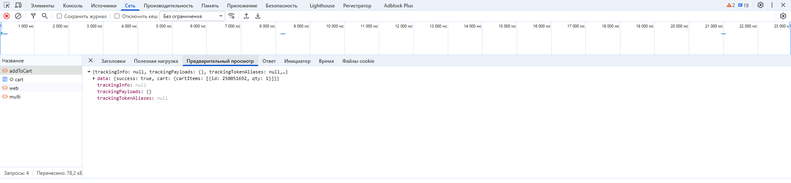

# tilda_computer-science_part2
Лабораторная работа №2
# Анализ веб-приложения и клиент-серверного взаимодействия

## 1. Исследуемая информационная система

Для выполнения лабораторной работы используются информационная система Ozon и пользовательский сценарий: поиск товара и добавление в корзину.

Ozon — онлайн-площадка, предназначенная для покупки и продажи товаров и отслеживания их местоположения (интернет-магазин). Сервис не требует написания программного кода, пользователь работает через веб-интерфейс, который формирует запросы к серверу, а сервер возвращает данные и обновляет состояние страницы.

В ходе лабораторной работы были выделены следующие основные компоненты:
- браузер пользователя;
- интерфейс сайта (frontend);
- клиентский JavaScript, управляющий редактированием страницы;
- сервисный API, принимающий запросы от клиента;
- backend, обрабатывающий данные;
- хранилище данных для сохранения информации о товарах, их нахождения в корзине пользователя;
- внешние ресурсы и сервисы.

## 2. Анализ HTTP-запросов

Все HTTP-запросы состоят из URL, HTTP-метода, заголовков, параметров и тела запроса. Для выполнения работы по их анализу использовалась вкладка **Сеть** в браузерных DevTools. HTTP-запросы были взяты на момент открытия главной страницы сайта Ozon. В результате были замечены сетевые обращения, обеспечивающие загрузку интерфейса, получение данных и передачу изменений на сервер.

| HTTP-метод |                                                                                   URL                                                                                  | Относится к API | Примечания     |
|:----------:|:----------------------------------------------------------------------------------------------------------------------------------------------------------------------:|-----------------|----------------|
| GET        | st.ozone.ru/s3/assets-66613/15867fe5/microfront/catalog-search.js                                                                                                      | Нет             |                |
| POST       | ozon.ru/api/composer-api.bx/_action/v2/getSearchTapTags                                                                                                                | Да              |                |
| GET        | ir.ozone.ru/s3/multimedia-f/wc300/6845028747.jpg                                                                                                                       | Нет             | Загружает файл |
| GET        | ozon.ru/api/entrypoint-api.bx/page/json/v2?url=%2F%3Flayout_container%3Dnp-recom-desk-final%26layout_page_index%3D3%26start_page_id%3Dd5dde56f9c5bb9b2ce9e1e60594bdd74 | Да              |                |
| POST       | xapi.ozon.ru/csp-log/s3-proxy-pass                                                                                                                                     | Нет             |                |

Таким образом, можно сделать следующие выводы:
- GET-запросы загружают HTML, CSS, JavaScript и изображения;
- POST-запросы отправляют данные на сервер после действий пользователя.

## 3. Анализ HTTP-ответов

После отправки запроса сервер возвращает HTTP-ответ, содержащий статус-код, заголовки и тело ответа. Для анализа был выбран следующий запрос: добавление товара в корзину. Был получен ответ с кодом статуса 200, что свидетельствует об успешном выполнении операции, после чего браузер изменил интерфейс и отправил результат в формате JSON.


Основные наблюдаемые заголовки:
- Content Type: application/json;
- Data: дата и время ответа;
- Server: название серверного программного обеспечения.

Пример структуры ответа, обнаруженный в разделе **Ответ** вкладки **Сеть**:

```json
{
    "trackingInfo": null,
    "trackingPayloads": {},
    "trackingTokenAliases": null,
    "data": {
        "success": true,
        "cart": {
            "cartItems": [
                {
                    "id": 250051692,
                    "qty": 1
                }
            ]
        }
    }
}
```

При изучении ответа были найдены данные об идентификаторе выбранного товара и его количестве. Браузер получал эти данные и изменял интерфейс при добавлении товара в корзину.



Наблюдаемые факты: после добавления товара в корзину сервер возвращает JSON-ответ, а в DevTools появляется HTTP-запрос с методом POST, который задаёт интерфейс корзины пользователя.

Предположения: запрос передаётся от frontend через API в backend, который изменяет внешний вид страницы и возвращает новую версию клиенту.

## 4. Анализ параметров и передаваемых данных

## 5. Анализ cookies

Cookies используются в веб-приложениях для хранения данных, которые браузер должен отправлять серверу при последующих запросах. Для сайта Ozon они были найдены в разделе **Файлы cookie** вкладки **Приложение**.

|            Имя cookie            |     Домен    | Срок действия    | Назначение                                                   | Флаги                      |
|:--------------------------------:|:------------:|------------------|--------------------------------------------------------------|----------------------------|
| guest                            | .ozon.ru     | менее суток      | идентификация авторизованного или анонимного пользователя    | SameSite                   |
| is_cookies_accepted              | .ozon.ru     | две недели       | проверка согласия пользователя на cookie                     | SameSite                   |
| ADDRESSBOOKBAR_WEB_CLARIFICATION | .www.ozon.ru | чуть более суток | идентификация геолокации пользователя                        |                            |
| x-o3-timezone                    | .ozon.ru     | около суток      | определение часового пояса пользователя                      | SameSite                   |
| abt_data                         | .ozone.ru    | около года       | хранение данных                                              | HttpOnly, Secure           |
| __Secure-user-id                 | .ozon.ru     | около года       | идентификационный номер пользователя                         | HttpOnly, Secure, SameSite |
| __Secure-ab-group                | .ozon.ru     | около года       | предположительно, распределение пользователей для тестировки | Secure, SameSite           |

## 6. Взаимодействие Frontend, API и Backend

## 7. Сопоставление с архитектурой из лабораторной работы №1

## 8. Схема взаимодействия компонентов

## 9. Вывод
